# Схема базы данных Skrezo

Актуально на миграцию **0019** (`alembic upgrade head`). Все таблицы —
PostgreSQL, ORM в `app/shared/db/models/` (по файлу на таблицу).

## Соглашения

- **`id`** — везде `UUID v4` (PK), если не указано иное.
- **`created_at` / `updated_at`** — `timestamptz`, серверные `now()` (у большинства
  таблиц; у чисто-логовых — только `created_at`).
- **Деньги** — целые сомы (`integer`), без копеек.
- **Телефоны** — E.164 (`text`), нормализуются на входе.
- `FK` — внешний ключ, `UK` — уникальный, `PK` — первичный ключ.
- Каскады: `ON DELETE CASCADE` (удаление родителя удаляет детей) или `SET NULL`
  (обнуляет ссылку) — указаны в разделе связей.

## Домены

| Домен | Таблицы |
|---|---|
| Справочники (i18n) | `city`, `city_translation`, `specialization`, `specialization_translation` |
| Аккаунты и клиники | `account`, `clinic`, `membership` |
| RBAC (права/роли) | `permission`, `role`, `role_permission` |
| Продажи / биллинг | `lead`, `subscription`, `subscription_event`, `tariff_version`, `tariff_package` |
| Аудит | `audit_log` |
| **Клиническое ядро** | `patient`, `patient_tooth`, `service`, `appointment`, `appointment_tooth` |
| **Расписание** | `clinic_working_hours`, `doctor_schedule`, `doctor_time_off` |
| **Касса клиники** | `cash_payment` |

---

## ER-диаграмма

```mermaid
erDiagram
    CITY ||--o{ CITY_TRANSLATION : "переводы"
    SPECIALIZATION ||--o{ SPECIALIZATION_TRANSLATION : "переводы"
    CITY ||--o{ CLINIC : "город"

    CLINIC ||--o{ MEMBERSHIP : "сотрудники"
    ACCOUNT ||--o{ MEMBERSHIP : "членства"
    ROLE ||--o{ MEMBERSHIP : "роль"
    SPECIALIZATION ||--o{ MEMBERSHIP : "спец. (опц.)"

    CLINIC ||--o{ ROLE : "роли клиники (NULL=шаблон)"
    ROLE ||--o{ ROLE_PERMISSION : ""
    PERMISSION ||--o{ ROLE_PERMISSION : ""

    CLINIC ||--o| SUBSCRIPTION : "подписка (1:1)"
    SUBSCRIPTION ||--o{ SUBSCRIPTION_EVENT : "история статусов"
    CLINIC ||--o{ LEAD : "конвертация (опц.)"

    ACCOUNT ||--o{ TARIFF_VERSION : "created_by"
    TARIFF_VERSION ||--o{ TARIFF_PACKAGE : "пакеты (clinic)"
    ACCOUNT ||--o{ AUDIT_LOG : "actor"

    PATIENT ||--o{ PATIENT_TOOTH : "одонтограмма"
    CLINIC ||--o{ SERVICE : "прайс"
    CLINIC ||--o{ APPOINTMENT : "приёмы"
    PATIENT ||--o{ APPOINTMENT : "пациент (глобальный)"
    MEMBERSHIP ||--o{ APPOINTMENT : "врач (опц.)"
    SERVICE ||--o{ APPOINTMENT : "основная услуга (опц.)"
    APPOINTMENT ||--o{ APPOINTMENT_TOOTH : "манипуляции"
    PATIENT_TOOTH ||--o{ APPOINTMENT_TOOTH : "зуб"
    SERVICE ||--o{ APPOINTMENT_TOOTH : "услуга (опц.)"
    MEMBERSHIP ||--o{ APPOINTMENT_TOOTH : "врач (опц.)"

    CLINIC ||--o{ CLINIC_WORKING_HOURS : "часы работы (7 дней)"
    CLINIC ||--o{ DOCTOR_SCHEDULE : "графики врачей"
    MEMBERSHIP ||--o{ DOCTOR_SCHEDULE : "врач"
    CLINIC ||--o{ DOCTOR_TIME_OFF : "отсутствия"
    MEMBERSHIP ||--o{ DOCTOR_TIME_OFF : "врач"

    CLINIC ||--o{ CASH_PAYMENT : "касса"
    APPOINTMENT ||--o{ CASH_PAYMENT : "оплата приёма"
    PATIENT ||--o{ CASH_PAYMENT : "плательщик"
    MEMBERSHIP ||--o{ CASH_PAYMENT : "кассир (опц.)"
    CASH_PAYMENT ||--o| CASH_PAYMENT : "возврат→платёж"

    ACCOUNT {
        uuid id PK
        text phone UK
        text full_name
        enum lang
        bool onboarded
        text password_hash "nullable"
        bool must_change_password
        bool is_platform_admin "команда Skrezo"
    }
    CLINIC {
        uuid id PK
        text name
        enum type "solo|clinic"
        uuid city_id FK "nullable"
        text address "nullable"
        text business_phone "nullable"
        enum lang
        text timezone "IANA, по умолч. Asia/Bishkek"
        int seats_limit "nullable"
        text support_notes "nullable"
    }
    MEMBERSHIP {
        uuid id PK
        uuid clinic_id FK
        uuid account_id FK
        uuid role_id FK
        uuid specialization_id FK "nullable"
        bool active
    }
    ROLE {
        uuid id PK
        uuid clinic_id FK "NULL=глобальный шаблон"
        text key "nullable"
        text name
        bool is_system
        bool is_owner
    }
    PERMISSION {
        uuid id PK
        text key UK
        text group_key
        text description
        int sort_order
    }
    ROLE_PERMISSION {
        uuid role_id FK "составной PK"
        uuid permission_id FK "составной PK"
    }
    CITY {
        uuid id PK
        int sort_order
        bool active
    }
    CITY_TRANSLATION {
        uuid id PK
        uuid city_id FK
        enum lang
        text value
    }
    SPECIALIZATION {
        uuid id PK
        int sort_order
        bool active
    }
    SPECIALIZATION_TRANSLATION {
        uuid id PK
        uuid specialization_id FK
        enum lang
        text value
    }
    LEAD {
        uuid id PK
        text full_name
        text phone UK
        text clinic_name
        text doctors_count_range "nullable"
        text comment "nullable"
        uuid converted_clinic_id FK "nullable"
        timestamptz created_at
    }
    SUBSCRIPTION {
        uuid id PK
        uuid clinic_id FK "UK: 1 на клинику"
        enum status
        timestamptz trial_started_at
        timestamptz trial_ends_at
        timestamptz card_attach_deadline "nullable"
        timestamptz card_attached_at "nullable"
        timestamptz current_period_start "nullable"
        timestamptz current_period_end "nullable"
        timestamptz cancelled_at "nullable"
    }
    SUBSCRIPTION_EVENT {
        uuid id PK
        uuid subscription_id FK
        enum from_status "nullable"
        enum to_status
        text reason "nullable"
        timestamptz created_at
    }
    TARIFF_VERSION {
        uuid id PK
        enum type "solo|clinic"
        int version "по типу, от 1"
        int price "nullable (solo)"
        int over_price "nullable (clinic Сеть)"
        uuid created_by FK
        timestamptz created_at
    }
    TARIFF_PACKAGE {
        uuid id PK
        uuid tariff_version_id FK
        text name
        int up_to "граница мест"
        int price
    }
    AUDIT_LOG {
        uuid id PK
        uuid actor_id FK "account"
        text action
        text entity_type
        uuid entity_id "nullable"
        jsonb payload "nullable"
        timestamptz created_at
    }
    PATIENT {
        uuid id PK
        text phone UK "глобальный дедуп"
        text first_name
        text last_name "nullable"
        text middle_name "nullable"
        text gender "nullable"
        date birth_date "nullable"
        text email "nullable"
        text avatar "nullable"
    }
    PATIENT_TOOTH {
        uuid id PK
        uuid patient_id FK
        smallint tooth_number "FDI"
        enum status "tooth_status"
        text note "nullable"
    }
    SERVICE {
        uuid id PK
        uuid clinic_id FK
        text name
        text description "nullable"
        int price "сомы"
        int duration "nullable, мин"
        bool active
    }
    APPOINTMENT {
        uuid id PK
        uuid clinic_id FK
        uuid patient_id FK
        uuid doctor_membership_id FK "nullable"
        uuid service_id FK "nullable, основная услуга"
        enum appointment_type
        timestamptz scheduled_at
        int duration_min "длительность, мин"
        enum status
        int price_total
        text comment "nullable"
    }
    APPOINTMENT_TOOTH {
        uuid id PK
        uuid appointment_id FK
        uuid patient_tooth_id FK
        uuid service_id FK "nullable"
        uuid doctor_membership_id FK "nullable"
        enum status "appointment_tooth_status"
        int price
        text comment "nullable"
        timestamptz created_at
    }
    CLINIC_WORKING_HOURS {
        uuid id PK
        uuid clinic_id FK
        smallint weekday "0=пн … 6=вс"
        time opens_at
        time closes_at
        time break_start "nullable, общий обед"
        time break_end "nullable"
        bool is_working
    }
    DOCTOR_SCHEDULE {
        uuid id PK
        uuid clinic_id FK
        uuid membership_id FK "врач"
        smallint weekday "0=пн … 6=вс"
        time starts_at
        time ends_at
        bool is_working
    }
    DOCTOR_TIME_OFF {
        uuid id PK
        uuid clinic_id FK
        uuid membership_id FK "врач"
        timestamptz starts_at
        timestamptz ends_at
        text reason "nullable"
    }
    CASH_PAYMENT {
        uuid id PK
        uuid clinic_id FK
        uuid appointment_id FK "приём"
        uuid patient_id FK "плательщик"
        int amount "сомы, > 0"
        enum method "cash|card|transfer"
        enum kind "payment|refund"
        uuid recorded_by_membership_id FK "кассир, nullable"
        uuid refunds_payment_id FK "исходный платёж (для возврата), nullable"
        text comment "nullable"
        timestamptz created_at
    }
```



> `UNIQUE(patient_id, tooth_number)` на `patient_tooth`; `UNIQUE(<entity>_id, lang)`
> на таблицах переводов. Расписание: `UNIQUE(clinic_id, weekday)` на
> `clinic_working_hours`, `UNIQUE(clinic_id, membership_id, weekday)` на
> `doctor_schedule`.
>
> **Приёмы одного врача не пересекаются** — EXCLUDE-констрейнт
> `ex_appointment_doctor_overlap` (`btree_gist`) на `appointment`:
> `doctor_membership_id WITH =` + `appointment_tstzrange(scheduled_at, duration_min) WITH &&`,
> только для `doctor_membership_id IS NOT NULL AND status <> 'cancelled'`. Проверки в
> коде недостаточно: два одновременных запроса заняли бы один слот. Выражение индекса
> обязано быть IMMUTABLE, а оператор `timestamptz + interval` — лишь STABLE, поэтому
> сложение завёрнуто в IMMUTABLE-функцию `appointment_tstzrange` (чистые минуты через
> `make_interval(mins => ...)` от таймзоны не зависят). Клиника хранит IANA-таймзону
> (`clinic.timezone`) — в ней считаются границы дня.
>
> Миграция 0020 закрывает дрейф схемы 0019: `appointment.scheduled_at` и метки
> `created_at`/`updated_at` клинических таблиц объявлены в ORM как NOT NULL, но
> создавались без ограничения. Пока БД принимала NULL, `PATCH {scheduledAt: null}`
> необратимо ломал врача: `tstzrange(NULL, NULL)` = `(,)` — неограниченный диапазон,
> пересекающийся со всем, а `appointment_tstzrange(NULL, …) IS NULL` (функция STRICT)
> выкидывал строку из GiST-индекса, снимая с неё защиту констрейнта. Существующие
> NULL миграция заполняет из `created_at` (иначе `now()`).

---

## Перечисления (enum)

| Enum (PG-тип) | Значения | Где |
|---|---|---|
| `lang_enum` | `kg`, `kz`, `ru`, `en` | account/clinic/переводы |
| `clinic_type` | `solo`, `clinic` | clinic, tariff_version |
| `subscription_status` | `trial`, `awaiting_card`, `active`, `past_due`, `blocked`, `cancelled` | subscription(_event) |
| `tooth_status` | `healthy`, `caries`, `filling`, `crown`, `implant`, `missing`, `broken`, `root`, `under_treatment` | patient_tooth |
| `appointment_type` | `consultation`, `treatment`, `operation`, `cleaning`, `xray` | appointment |
| `appointment_status` | `scheduled`, `confirmed`, `in_progress`, `completed`, `cancelled`, `no_show` | appointment |
| `appointment_tooth_status` | `planned`, `started`, `completed`, `cancelled` | appointment_tooth |
| `payment_method` | `cash`, `card`, `transfer` | cash_payment |
| `payment_kind` | `payment`, `refund` | cash_payment |

---

## Клиническое ядро — как читать историю зуба

Пациент **глобальный** (не принадлежит клинике). Клиника «видит» пациента, если у
неё есть с ним `appointment`. **Сквозная история зуба** (по всем клиникам):

```
patient ──1:N── patient_tooth ──1:N── appointment_tooth ──N:1── appointment ──N:1── clinic
                     (текущее                (манипуляция)          (приём)        + doctor(membership)
                      состояние зуба)                                              + service
```

- **Одонтограмма** = строки `patient_tooth` (по одной на зуб, `UNIQUE`).
- **История зуба** = все `appointment_tooth` для этого `patient_tooth`, JOIN к
  `appointment` (дата, клиника), `membership→account` (врач), `service` (услуга).
- **Врач** — это `membership` (account + роль в клинике), отдельной таблицы
  `doctors` нет.

---

## Каскады удаления (ON DELETE)

| Дочерняя таблица | Ссылка | Поведение |
|---|---|---|
| `membership` | clinic_id, account_id | CASCADE |
| `role` | clinic_id | CASCADE |
| `role_permission` | role_id, permission_id | CASCADE |
| `*_translation` | <entity>_id | CASCADE |
| `subscription` / `subscription_event` | clinic_id / subscription_id | CASCADE |
| `tariff_package` | tariff_version_id | CASCADE |
| `patient_tooth` | patient_id | CASCADE |
| `service` | clinic_id | CASCADE |
| `appointment` | clinic_id, patient_id | CASCADE |
| `appointment` | doctor_membership_id, service_id | SET NULL |
| `clinic_working_hours` | clinic_id | CASCADE |
| `doctor_schedule` / `doctor_time_off` | clinic_id, membership_id | CASCADE |
| `appointment_tooth` | appointment_id, patient_tooth_id | CASCADE |
| `appointment_tooth` | service_id, doctor_membership_id | SET NULL |
| `cash_payment` | clinic_id, appointment_id, patient_id | CASCADE |
| `cash_payment` | recorded_by_membership_id, refunds_payment_id | SET NULL |
| `clinic` | city_id | (без каскада) |
| `tariff_version` / `audit_log` | created_by / actor_id → account | (без каскада) |
| `lead` | converted_clinic_id | (без каскада, nullable) |
