# Схема базы данных Skrezo

Актуально на миграцию **0037** (`alembic upgrade head`). Все таблицы —
PostgreSQL, ORM в `app/shared/db/models/` (по файлу на таблицу).

## Соглашения

- **`id`** — везде `UUID v4` (PK), если не указано иное.
- **`created_at` / `updated_at`** — `timestamptz`, серверные `now()` (у большинства
  таблиц; у чисто-логовых — только `created_at`).
- **Деньги** — целые **тыйыны** (`integer`), 1 сом = 100 тыйын. Колонки несут
  суффикс `_tiyin`, чтобы единица не угадывалась по имени.
- **Телефоны** — E.164 (`text`), нормализуются на входе.
- `FK` — внешний ключ, `UK` — уникальный, `PK` — первичный ключ.
- Каскады: `ON DELETE CASCADE` (удаление родителя удаляет детей) или `SET NULL`
  (обнуляет ссылку) — указаны в разделе связей.

## Домены

| Домен | Таблицы |
|---|---|
| Справочники (i18n) | `city`, `city_translation`, `specialization`, `specialization_translation` |
| Аккаунты и клиники | `account`, `clinic`, `membership` |
| RBAC (права/роли) | `permission`, `role`, `role_permission` |
| Продажи / биллинг | `clinic_application` (единая очередь заявок: лиды с лендинга и заявки через OTP), `subscription`, `subscription_event`, `tariff_version`, `tariff_package`, `clinic_custom_plan` — спецплан клиники от Skrezo (свои места и цена вместо пакетов, строка на клинику), `plan_request` — заявки «нужно больше мест» (открытая одна на клинику) |
| Аудит | `audit_log` |
| Фоновые задачи | `job_run` |
| **Клиническое ядро** | `patient`, `patient_tooth`, `patient_file`, `service`, `appointment`, `appointment_item`, `appointment_item_tooth` |
| **Расписание** | `clinic_working_hours`, `doctor_schedule`, `doctor_time_off` |
| **Касса клиники** | `cash_payment` |
| **Напоминания** | `reminder_mark` — отметки «напомнили» (пациент, повод, приём-источник, кто и когда) |
| **WhatsApp-канал** | `clinic_whatsapp` — номер клиники: общий токен Skrezo (привязка командой) либо собственный бизнес-токен клиники из Embedded Signup, только зашифрованным (`access_token_enc`, Fernet); там же «нужно переподключить» и ход переноса данных приложения. `whatsapp_template` — шаблоны. `whatsapp_contact` — адресная книга приложения WhatsApp Business (имена в списке диалогов). `whatsapp_history_message` — архив переписки из приложения до подключения: отдельно от живой ленты `ai_message`, упорядочен по `sent_at` |

---

## ER-диаграмма

```mermaid
erDiagram
    CITY ||--o{ CITY_TRANSLATION : "переводы"
    SPECIALIZATION ||--o{ SPECIALIZATION_TRANSLATION : "переводы"
    CITY ||--o{ CLINIC : "город"

    CLINIC ||--o{ MEMBERSHIP : "сотрудники"
    ACCOUNT ||--o{ MEMBERSHIP : "членства"
    ROLE ||--o{ MEMBERSHIP : "роль"
    SPECIALIZATION ||--o{ MEMBERSHIP : "спец. (опц.)"

    CLINIC ||--o{ ROLE : "роли клиники (NULL=шаблон)"
    ROLE ||--o{ ROLE_PERMISSION : ""
    PERMISSION ||--o{ ROLE_PERMISSION : ""

    CLINIC ||--o| SUBSCRIPTION : "подписка (1:1)"
    SUBSCRIPTION ||--o{ SUBSCRIPTION_EVENT : "история статусов"
    CLINIC ||--o{ CLINIC_APPLICATION : "конвертация (опц.)"
    CITY ||--o{ CLINIC_APPLICATION : "город заявки"
    ACCOUNT ||--o{ CLINIC_APPLICATION : "кто рассмотрел (опц.)"

    ACCOUNT ||--o{ TARIFF_VERSION : "created_by"
    TARIFF_VERSION ||--o{ TARIFF_PACKAGE : "пакеты (clinic)"
    ACCOUNT ||--o{ AUDIT_LOG : "actor"

    PATIENT ||--o{ PATIENT_TOOTH : "одонтограмма"
    PATIENT ||--o{ PATIENT_FILE : "снимки и документы"
    CLINIC ||--o{ PATIENT_FILE : "кто загрузил"
    CLINIC ||--o{ SERVICE : "прайс"
    CLINIC ||--o{ APPOINTMENT : "приёмы"
    PATIENT ||--o{ APPOINTMENT : "пациент (глобальный)"
    MEMBERSHIP ||--o{ APPOINTMENT : "врач (опц.)"
    SERVICE ||--o{ APPOINTMENT : "основная услуга (опц.)"
    SERVICE ||--o{ SERVICE_DOCTOR : "кто выполняет"
    MEMBERSHIP ||--o{ SERVICE_DOCTOR : "врач"
    APPOINTMENT ||--o{ APPOINTMENT_ITEM : "позиции чека"
    APPOINTMENT_ITEM ||--o{ APPOINTMENT_ITEM_TOOTH : "зубы позиции"
    PATIENT_TOOTH ||--o{ APPOINTMENT_ITEM_TOOTH : "зуб"
    SERVICE ||--o{ APPOINTMENT_ITEM : "услуга (опц.)"
    MEMBERSHIP ||--o{ APPOINTMENT_ITEM : "врач (опц.)"

    CLINIC ||--o{ CLINIC_WORKING_HOURS : "часы работы (7 дней)"
    CLINIC ||--o{ DOCTOR_SCHEDULE : "графики врачей"
    MEMBERSHIP ||--o{ DOCTOR_SCHEDULE : "врач"
    CLINIC ||--o{ DOCTOR_TIME_OFF : "отсутствия"
    MEMBERSHIP ||--o{ DOCTOR_TIME_OFF : "врач"

    CLINIC ||--o{ CASH_PAYMENT : "касса"
    APPOINTMENT ||--o{ CASH_PAYMENT : "оплата приёма"
    PATIENT ||--o{ CASH_PAYMENT : "плательщик"
    MEMBERSHIP ||--o{ CASH_PAYMENT : "кассир (опц.)"
    CASH_PAYMENT ||--o| CASH_PAYMENT : "возврат→платёж"

    ACCOUNT {
        uuid id PK
        text phone UK
        text full_name
        enum lang
        bool onboarded
        text password_hash "NULL — вход по коду; заполнен только у команды Skrezo"
        bool must_change_password "осмыслен только вместе с паролем"
        bool is_platform_admin "команда Skrezo"
        timestamptz blocked_at "NULL — действующий; иначе доступ отобран целиком"
        text blocked_reason "причина блокировки (для админки)"
    }
    CLINIC {
        uuid id PK
        text name
        enum type "solo|clinic"
        uuid city_id FK "nullable"
        text address "nullable"
        text business_phone "nullable"
        enum lang
        text timezone "IANA, по умолч. Asia/Bishkek"
        int seats_limit "nullable"
        text support_notes "nullable"
    }
    MEMBERSHIP {
        uuid id PK
        uuid clinic_id FK
        uuid account_id FK
        uuid role_id FK
        uuid specialization_id FK "nullable"
        bool active
    }
    ROLE {
        uuid id PK
        uuid clinic_id FK "NULL=глобальный шаблон"
        text key "nullable"
        text name
        bool is_system
        bool is_owner
        int max_discount_percent "потолок скидки роли, 0..100"
    }
    PERMISSION {
        uuid id PK
        text key UK
        text group_key
        text description
        int sort_order
        bool in_trial "доступно ли на триале (настройка админки)"
    }
    ROLE_PERMISSION {
        uuid role_id FK "составной PK"
        uuid permission_id FK "составной PK"
    }
    CITY {
        uuid id PK
        int sort_order
        bool active
    }
    CITY_TRANSLATION {
        uuid id PK
        uuid city_id FK
        enum lang
        text value
    }
    SPECIALIZATION {
        uuid id PK
        int sort_order
        bool active
    }
    SPECIALIZATION_TRANSLATION {
        uuid id PK
        uuid specialization_id FK
        enum lang
        text value
    }
    CLINIC_APPLICATION {
        uuid id PK
        text company_name "nullable: у лида может не быть"
        uuid city_id FK "nullable: у лида нет"
        enum doctors_count "nullable; 2-5|6-10|10+"
        text full_name "nullable: у заявки из приложения нет"
        text phone "не уникален; подтверждён OTP, если phone_verified"
        boolean phone_verified "true — OTP, false — лид с лендинга"
        text source "nullable: utm_source/referrer"
        text comment "nullable"
        enum status "pending|reviewed|rejected"
        uuid converted_clinic_id FK "nullable: клиника по заявке"
        uuid reviewed_by_account_id FK "nullable"
        timestamptz reviewed_at "nullable"
        timestamptz created_at
        timestamptz updated_at
    }
    SUBSCRIPTION {
        uuid id PK
        uuid clinic_id FK "UK: 1 на клинику"
        enum status
        timestamptz trial_started_at
        timestamptz trial_ends_at
        timestamptz card_attach_deadline "nullable"
        timestamptz card_attached_at "nullable"
        timestamptz current_period_start "nullable"
        timestamptz current_period_end "nullable"
        timestamptz cancelled_at "nullable"
        timestamptz trial_warning_sent_at "nullable: предупреждение о конце триала"
        timestamptz period_warning_sent_at "nullable: то же для оплаченного периода"
    }
    SUBSCRIPTION_EVENT {
        uuid id PK
        uuid subscription_id FK
        enum from_status "nullable"
        enum to_status
        text reason "nullable"
        timestamptz created_at
    }
    TARIFF_VERSION {
        uuid id PK
        enum type "solo|clinic"
        int version "по типу, от 1"
        int price_tiyin "nullable (solo)"
        int over_price_tiyin "nullable (clinic Сеть)"
        uuid created_by FK
        timestamptz created_at
    }
    TARIFF_PACKAGE {
        uuid id PK
        uuid tariff_version_id FK
        text name
        int up_to "граница мест"
        int price_tiyin
    }
    AUDIT_LOG {
        uuid id PK
        uuid actor_id FK "account"
        uuid clinic_id FK "nullable: клиника (пусто — действие Skrezo)"
        text action
        text entity_type
        uuid entity_id "nullable"
        jsonb payload "nullable"
        timestamptz created_at
    }
    PATIENT_FILE {
        uuid id PK
        uuid patient_id FK
        uuid clinic_id FK "кто загрузил"
        uuid appointment_id FK "nullable"
        enum kind "images|files"
        text original_name "как прислали"
        text stored_path "путь в хранилище, имя генерируем мы"
        text mime
        int size_bytes
        text comment "nullable"
        uuid uploaded_by_membership_id FK "nullable"
        timestamptz created_at
        timestamptz deleted_at "nullable: мягкое удаление"
    }
    JOB_RUN {
        uuid id PK
        text job_name "expire_trials, send_notification, …"
        enum status "running|ok|failed"
        int attempt "номер попытки arq"
        timestamptz started_at
        timestamptz finished_at "nullable: запуск не завершён"
        text detail "nullable: результат или ошибка"
    }
    PATIENT {
        uuid id PK
        text phone UK "глобальный дедуп"
        text first_name
        text last_name "nullable"
        text middle_name "nullable"
        text gender "nullable"
        date birth_date "nullable"
        text email "nullable"
        text avatar "nullable"
        text note "nullable, заметка о пациенте"
    }
    PATIENT_TOOTH {
        uuid id PK
        uuid patient_id FK
        smallint tooth_number "FDI"
        enum status "tooth_status"
        text note "nullable"
    }
    SERVICE {
        uuid id PK
        uuid clinic_id FK
        text name
        text description "nullable"
        int price_tiyin "тыйыны"
        int duration "nullable, мин"
        enum tooth_outcome "nullable: в какое состояние приводит зуб"
        bool active
    }
    SERVICE_DOCTOR {
        uuid service_id PK_FK
        uuid membership_id PK_FK "строк нет = услугу делают все"
    }
    APPOINTMENT {
        uuid id PK
        uuid clinic_id FK
        uuid patient_id FK
        uuid doctor_membership_id FK "nullable"
        uuid service_id FK "nullable, основная услуга"
        enum appointment_type
        timestamptz scheduled_at "nullable только у draft/cancelled"
        int duration_min "длительность, мин"
        enum status
        int price_total_tiyin "итог К ОПЛАТЕ: позиции минус скидка; отмена обнуляет"
        int discount_percent "скидка, 0..100"
        int discount_tiyin "сумма скидки"
        text comment "nullable"
        enum cancel_reason "nullable, только у cancelled"
        text cancel_comment "nullable, обязателен при other"
        bool no_charge "приём закрыт как бесплатный"
        text no_charge_comment "nullable, обязателен при no_charge"
    }
    APPOINTMENT_ITEM {
        uuid id PK
        uuid appointment_id FK
        uuid service_id FK "nullable"
        uuid doctor_membership_id FK "nullable"
        enum status "appointment_item_status"
        int price_tiyin "цена ЗА ЕДИНИЦУ на момент оказания"
        int quantity "CHECK > 0"
        int position "порядок в чеке, с нуля"
        text comment "nullable"
        timestamptz created_at
    }
    APPOINTMENT_ITEM_TOOTH {
        uuid item_id FK "составной PK"
        uuid patient_tooth_id FK "составной PK"
    }
    CLINIC_WORKING_HOURS {
        uuid id PK
        uuid clinic_id FK
        smallint weekday "0=пн … 6=вс"
        time opens_at
        time closes_at
        time break_start "nullable, общий обед"
        time break_end "nullable"
        bool is_working
    }
    DOCTOR_SCHEDULE {
        uuid id PK
        uuid clinic_id FK
        uuid membership_id FK "врач"
        smallint weekday "0=пн … 6=вс"
        time starts_at
        time ends_at
        bool is_working
    }
    DOCTOR_TIME_OFF {
        uuid id PK
        uuid clinic_id FK
        uuid membership_id FK "врач"
        timestamptz starts_at
        timestamptz ends_at
        text reason "nullable"
    }
    CASH_PAYMENT {
        uuid id PK
        uuid clinic_id FK
        uuid appointment_id FK "приём"
        uuid patient_id FK "плательщик"
        int amount_tiyin "тыйыны, > 0"
        enum method "cash|card|transfer"
        enum kind "payment|refund"
        uuid recorded_by_membership_id FK "кассир, nullable"
        uuid refunds_payment_id FK "исходный платёж (возвратов по нему может быть несколько), nullable"
        text comment "nullable"
        timestamptz created_at
    }
```



> `UNIQUE(patient_id, tooth_number)` на `patient_tooth`; `UNIQUE(<entity>_id, lang)`
> на таблицах переводов. Расписание: `UNIQUE(clinic_id, weekday)` на
> `clinic_working_hours`, `UNIQUE(clinic_id, membership_id, weekday)` на
> `doctor_schedule`.
>
> **Приёмы одного врача не пересекаются** — EXCLUDE-констрейнт
> `ex_appointment_doctor_overlap` (`btree_gist`) на `appointment`:
> `doctor_membership_id WITH =` + `appointment_tstzrange(scheduled_at, duration_min) WITH &&`,
> только для `doctor_membership_id IS NOT NULL AND status <> 'cancelled'`. Проверки в
> коде недостаточно: два одновременных запроса заняли бы один слот. Выражение индекса
> обязано быть IMMUTABLE, а оператор `timestamptz + interval` — лишь STABLE, поэтому
> сложение завёрнуто в IMMUTABLE-функцию `appointment_tstzrange` (чистые минуты через
> `make_interval(mins => ...)` от таймзоны не зависят). Клиника хранит IANA-таймзону
> (`clinic.timezone`) — в ней считаются границы дня.
>
> **Возвраты кассы.** Сумма возвратов по платежу ограничена самим платежом, но
> констрейнтом это не выразить (ограничение на агрегат): правило стережёт
> прикладной слой, беря строку платежа `SELECT ... FOR UPDATE` — иначе два
> параллельных возврата увидели бы один остаток. Частичный индекс
> `ix_cash_payment_refunds_payment` (0028) обслуживает агрегат «сколько
> возвращено», который подмешивается к каждой строке журнала.
>
> **Одонтограмма и приём.** `patient_tooth.status` обновляется при завершении
> приёма по `service.tooth_outcome` сделанных позиций (NULL — услуга зуб не
> меняет). Если по зубу в одном приёме несколько работ, побеждает последняя по
> `appointment_item.position`: `created_at` у строк одного приёма одинаков —
> это время транзакции, и без явного порядка выбор был бы за планом запроса.
>
> **Скидка.** Хранится процентом (`discount_percent`) — так её ограничивает
> потолок роли (`role.max_discount_percent`), — и суммой (`discount_tiyin`), без
> которой чек не сходится с кассой в целых тыйынах. Обе величины пересчитывает
> прикладной слой при любой правке позиций; `price_total_tiyin` остаётся итогом
> **к оплате**, поэтому долг считается по нему без изменений.
>
> **CHECK'и приёма.** `ck_appointment_scheduled_at_required`: дата обязательна
> у всех статусов, кроме `draft` и `cancelled` — приём, который не состоялся, до
> даты так и не дошёл. `ck_appointment_no_charge_comment` (0027): флаг
> `no_charge` без пояснения запрещён — иначе «бесплатно» снова превращается в
> нулевой чек, только с галочкой.
>
> Миграция 0020 закрывает дрейф схемы 0019: `appointment.scheduled_at` и метки
> `created_at`/`updated_at` клинических таблиц объявлены в ORM как NOT NULL, но
> создавались без ограничения. Пока БД принимала NULL, `PATCH {scheduledAt: null}`
> необратимо ломал врача: `tstzrange(NULL, NULL)` = `(,)` — неограниченный диапазон,
> пересекающийся со всем, а `appointment_tstzrange(NULL, …) IS NULL` (функция STRICT)
> выкидывал строку из GiST-индекса, снимая с неё защиту констрейнта. Существующие
> NULL миграция заполняет из `created_at` (иначе `now()`).

---

## Заявки клиник — одна очередь, две двери

Таблицы `lead` больше нет (миграция 0070): лиды с лендинга лежат в
`clinic_application` вместе с заявками из приложения, и команда видит всё одним
`GET /admin/clinic-applications`.

| Дверь | `phone_verified` | Что заполнено |
|---|---|---|
| `POST /clinic-applications` (OTP) | `true` | `company_name`, `city_id`, `doctors_count`, `phone`; `full_name` пуст |
| `POST /leads` (лендинг, без кода) | `false` | `full_name`, `phone`; `company_name`, `doctors_count`, `comment`, `source` — если пришли; `city_id` всегда пуст |

Что держит сама схема, а не только код:

* `company_name`, `city_id`, `doctors_count` — nullable. **`ck_clinic_application_verified_complete`**:
  `phone_verified = false OR (company_name, city_id, doctors_count все NOT NULL)` —
  заявка с подтверждённым телефоном всегда полная.
* **`ck_clinic_application_lead_named`**: `phone_verified = true OR full_name IS NOT NULL` —
  у лида имя обязательно.
* **`ux_clinic_application_pending_lead_phone`** — частичный уникальный индекс по
  `phone` `WHERE status = 'pending' AND phone_verified = false`: не больше одной
  открытой заявки с лендинга на номер (защита дедупа от гонки двух отправок).
  Заявки через OTP по-прежнему могут повторяться; `reviewed`/`rejected` лиды
  индексом не учитываются — человек вправе прийти снова.
* `phone_verified` — NOT NULL **без** server_default: обе двери задают значение явно
  (миграция добавляла колонку с `true`, поскольку все старые заявки пришли через OTP,
  и сняла умолчание).
* `converted_clinic_id` → `clinic.id` `ON DELETE SET NULL` — семантика конверсии для
  дашборда (`conversion()` и тренд «Заявки» считают строки этой таблицы);
  выставляется провижинингом (`ProvisionCommand.application_id`) — единственный
  живой путь `POST /admin/clients` с `applicationId`. Заявка берётся под
  `SELECT ... FOR UPDATE`; уже сконвертированная (`converted_clinic_id IS NOT NULL`)
  отклоняется `409 application_already_converted`. В той же транзакции заявка
  становится `reviewed` (рассмотревший — заводивший клиента сотрудник Skrezo, если
  статус был не `reviewed`). Если клинику удалят, FK обнулит поле и заявку можно
  конвертировать снова.
* `doctors_count` из лида — только если свободный текст формы после `trim` ровно
  `2-5` | `6-10` | `10+`, иначе `NULL`.

Миграция 0070 переносит каждый `lead` в заявку `pending` с `phone_verified = false`
(id и дата создания сохраняются) и удаляет таблицу. `downgrade` воссоздаёт `lead` и
возвращает туда неподтверждённые заявки — по одной на телефон (самую раннюю; название
клиники, если пусто, заменяется именем контакта); статус рассмотрения и `source` при
откате теряются.

---

## Перечисления (enum)

| Enum (PG-тип) | Значения | Где |
|---|---|---|
| `lang_enum` | `kg`, `kz`, `ru`, `en` | account/clinic/переводы |
| `clinic_type` | `solo`, `clinic` | clinic, tariff_version |
| `subscription_status` | `trial`, `trial_expired`, `awaiting_card`, `active`, `past_due`, `blocked`, `cancelled` | subscription(_event) |
| `tooth_status` | `healthy`, `caries`, `filling`, `crown`, `implant`, `missing`, `broken`, `root`, `under_treatment` | patient_tooth |
| `appointment_type` | `consultation`, `treatment`, `operation`, `cleaning`, `xray` | appointment |
| `appointment_status` | `draft`, `scheduled`, `confirmed`, `arrived`, `in_progress`, `completed`, `cancelled`, `no_show` | appointment |
| `appointment_item_status` | `planned`, `started`, `completed`, `cancelled` | appointment_item |
| `payment_method` | `cash`, `card`, `transfer` | cash_payment |
| `payment_kind` | `payment`, `refund` | cash_payment |
| `doctors_count_range` | `2-5`, `6-10`, `10+` | clinic_application |
| `clinic_application_status` | `pending`, `reviewed`, `rejected` | clinic_application |
| `cancel_reason` | `patient_request`, `patient_illness`, `clinic_reschedule`, `doctor_unavailable`, `duplicate`, `other` | appointment |
| `job_run_status` | `running`, `ok`, `failed` | job_run |
| `file_kind` | `images`, `files` | patient_file |

---

## Клиническое ядро — как читать историю зуба

Пациент **глобальный** (не принадлежит клинике). Клиника «видит» пациента, если у
неё есть с ним `appointment`. **Сквозная история зуба** (по всем клиникам):

```
patient ─1:N─ patient_tooth ─1:N─ appointment_item_tooth ─N:1─ appointment_item ─N:1─ appointment ─N:1─ clinic
                   (текущее              (связка «позиция↔зуб»)      (строка чека)         (приём)      + doctor(membership)
                    состояние зуба)                                                                     + service
```

- **Одонтограмма** = строки `patient_tooth` (по одной на зуб, `UNIQUE`).
- **История зуба** = все позиции, связанные с этим `patient_tooth` через
  `appointment_item_tooth`, JOIN к `appointment` (дата, клиника),
  `membership→account` (врач), `service` (услуга). Связь многие-ко-многим: одна
  позиция может покрывать несколько зубов (мост) или ни одного (чистка).
- **Врач** — это `membership` (account + роль в клинике), отдельной таблицы
  `doctors` нет.

---

## Каскады удаления (ON DELETE)

| Дочерняя таблица | Ссылка | Поведение |
|---|---|---|
| `membership` | clinic_id, account_id | CASCADE |
| `role` | clinic_id | CASCADE |
| `role_permission` | role_id, permission_id | CASCADE |
| `*_translation` | <entity>_id | CASCADE |
| `subscription` / `subscription_event` | clinic_id / subscription_id | CASCADE |
| `tariff_package` | tariff_version_id | CASCADE |
| `patient_tooth` | patient_id | CASCADE |
| `service` | clinic_id | CASCADE |
| `appointment` | clinic_id, patient_id | CASCADE |
| `appointment` | doctor_membership_id, service_id | SET NULL |
| `clinic_working_hours` | clinic_id | CASCADE |
| `doctor_schedule` / `doctor_time_off` | clinic_id, membership_id | CASCADE |
| `appointment_item` | appointment_id | CASCADE |
| `appointment_item` | service_id, doctor_membership_id | SET NULL |
| `appointment_item_tooth` | item_id, patient_tooth_id | CASCADE |
| `cash_payment` | clinic_id, appointment_id, patient_id | CASCADE |
| `cash_payment` | recorded_by_membership_id, refunds_payment_id | SET NULL |
| `clinic` | city_id | (без каскада) |
| `tariff_version` / `audit_log` | created_by / actor_id → account | (без каскада) |
| `clinic_application` | city_id | (без каскада, nullable) |
| `clinic_application` | converted_clinic_id | SET NULL |
| `clinic_application` | reviewed_by_account_id | SET NULL |
